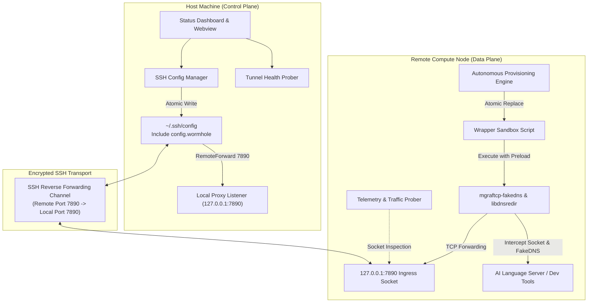

# AG-Wormhole Technical Architecture

This document provides a comprehensive deep-dive into the architectural foundations, plane separation, syscall interception mechanics, and telemetry systems powering **AG-Wormhole**.

---

## 1. Dual-Plane System Architecture

AG-Wormhole decouples proxy operations into two distinct runtime planes:
- **Control Plane**: Manages state reconciliation, configuration lifecycle, user interactions, and atomic SSH configuration management on the local machine.
- **Data Plane**: Intercepts, transforms, and forwards TCP socket traffic and DNS queries from remote compute processes back through the secure SSH tunnel.



---

## 2. Zero-Privilege Syscall Redirection & FakeDNS Mechanics

In enterprise remote compute environments, standard developers lack `sudo` or `CAP_NET_ADMIN` privileges required for `iptables`, `nftables`, or TUN/TAP interface manipulation. Additionally, remote servers often reside behind restricted internal DNS nameservers that poison or block external developer endpoints.

### Syscall Interception Pipeline
1. **Dynamic Linker Hooking (`libdnsredir.so`)**:
   AG-Wormhole injects `libdnsredir.so` into the target process environment via `LD_PRELOAD`. This captures libc socket calls including `getaddrinfo()`, `connect()`, and `sendto()`.
2. **FakeDNS Virtual Address Mapping**:
   When the Language Server queries a blocked domain (e.g. Google AI APIs), the redirection library generates a synthetic loopback IP address (within the `127.128.0.0/16` subnet) and registers the mapping inside `mgraftcp-fakedns`.
3. **Transparent SOCKS5 / HTTP Encapsulation**:
   When the application attempts to initiate a TCP handshake to that synthetic IP, `mgraftcp-fakedns` captures the syscall, extracts the mapped domain name from its table, and converts the TCP connection into an upstream SOCKS5 or HTTP CONNECT request directed at `127.0.0.1:7890`.
4. **Go Runtime Compatibility**:
   Go binaries dynamically link against libc when CGO is enabled, but default to Go's internal pure Go DNS resolver when compiled statically. AG-Wormhole explicitly exports:
   ```bash
   export GODEBUG="netdns=cgo"
   ```
   This guarantees that Go's runtime executes standard libc resolver routines, enabling the `LD_PRELOAD` hooks to intercept DNS lookups reliably.

---

## 3. End-to-End Sequence Diagram

```mermaid
sequenceDiagram
    autonumber
    participant U as Developer
    participant L as AG-Wormhole Local Extension
    participant SSH as SSH Client
    participant R as AG-Wormhole Remote Extension
    participant P as Provisioner & Engine
    participant LS as Language Server
    participant LP as Local Proxy (Clash/V2Ray)

    U->>L: Open Local Project Window
    L->>L: Verify Local Proxy Listener (127.0.0.1:7890)
    L->>SSH: Write ~/.ssh/config.wormhole & Include Directive
    U->>SSH: Connect to Remote Server via SSH
    SSH->>SSH: Open Reverse Port Forward (Remote:7890 -> Local:7890)
    
    SSH->>R: Launch Remote Extension Host
    R->>P: Check Server Workspace & Target Binaries
    P->>P: Backup language_server_linux_* to .bak
    P->>P: Write Executable Wrapper Sandbox
    P->>LS: Launch Language Server via mgraftcp-fakedns
    
    LS->>P: Issue DNS / Network Request
    P->>P: Intercept Syscall & FakeDNS Synthesis
    P->>SSH: Send Proxied TCP Packets to 127.0.0.1:7890
    SSH->>LP: Forward Packets through Reverse SSH Tunnel
    LP->>Internet: Uplink to Remote Service / AI API
    Internet-->>LP: Response Payload
    LP-->>SSH-->>P-->>LS: Transparent Data Return
```

---

## 4. Self-Healing & Fault-Tolerant Provisioning

### Worker Lifecycle Management
Modern language servers frequently operate in persistent worker modes (`--persistent_mode`). When an existing language server is already running unproxied, updating wrapper files on disk does not immediately affect the active process.

The AG-Wormhole Provisioner addresses this through intelligent state inspection:
1. Scans the process table via `ps aux` for active `language_server_linux` instances.
2. Identifies whether the current process is wrapped by `mgraftcp`.
3. If persistent mode is active without proxy interception, sends `SIGTERM` (followed by `SIGKILL` if unyielding) to allow Antigravity IDE's extension host to immediately respawn the language server through the newly deployed wrapper.

### Atomic Rollback Safety
Every binary intercepted by AG-Wormhole has an exact pre-modification clone preserved as `<binary_name>.bak`. If the user executes the rollback command, AG-Wormhole atomically moves `.bak` back to the original filename and cleans up the wrapper script, guaranteeing zero residual impact on the remote filesystem.

---

## 5. Live Telemetry Engine

The telemetry engine passively monitors socket connections without modifying application data:
- Inspects TCP socket state tables via `ss -tn state established` targeted at the designated ingress port.
- Maintains rolling session metrics: active simultaneous sockets, cumulative handshakes, and uptime duration.
- Reports real-time connection counters into the Webview Control Center.

