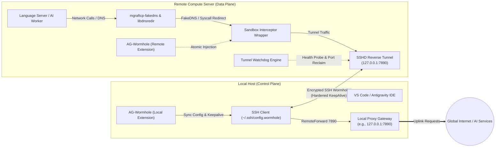

# AG-Wormhole

**AG-Wormhole** is a zero-privilege, dual-plane proxy tunnel and syscall redirection sandbox engineered for seamless remote development in constrained network environments. It bridges isolated remote developer compute nodes with local or designated upstream proxy gateways without requiring root privileges, iptables tampering, or global system-wide environment pollution.

---

## High-Availability & Anti-Disconnect Architecture

To prevent frequent SSH tunnel disconnects, dead socket locks, and silent forwarding failures, AG-Wormhole embeds an end-to-end resilience stack:

### 1. Hardened SSH Keepalive & Timeout Defense
- **Bidirectional Heartbeats**: Injects `ServerAliveInterval 15` and `ServerAliveCountMax 3` into `~/.ssh/config.wormhole`, preventing NAT routers and stateful firewalls from terminating idle connections.
- **Deadlock Mitigation**: Sets `ConnectTimeout 15` and `ConnectionAttempts 3` to prevent infinite hangs during network blackouts and automatically retries transient handshakes.
- **Socket Unlink on Bind**: Configures `StreamLocalBindUnlink yes` and `ExitOnForwardFailure no` so that stale socket files do not trigger port binding collisions or crash the SSH session.
- **Middlebox DSCP Safety**: Configures `IPQoS none` and hardware-accelerated AEAD/CTR cipher suites (`chacha20-poly1305@openssh.com,aes128-gcm@openssh.com,aes256-gcm@openssh.com,aes128-ctr,aes256-ctr`) to prevent stateful firewalls, VPNs, and Wi-Fi routers from dropping DSCP-marked SSH packets mid-session.
- **Multiplexing Recommendations**: Supports SSH connection multiplexing (`ControlMaster auto`, `ControlPersist 10m`) to maintain persistent master sockets across window reloads.

### 2. Autonomous Watchdog & Self-Healing Engine (`TunnelWatchdog`)
- **Low-Overhead Probes**: Probes tunnel endpoints every 10 seconds (configurable via `ag-wormhole.watchdogInterval`) using a 3-state health model (`HEALTHY`, `DEGRADED`, `DISCONNECTED`) with throttled L7 validation to prevent SSH `forwarded-tcpip` channel storms.
- **Local Gateway Auto-Reconnection**: Automatically detects when local proxy software (Clash, V2Ray, Mihomo) goes online, immediately triggering SSH reverse tunnel synchronization.
- **Session-Safe Zombie Port Auto-Reclaim**: When connection loss is detected and `ag-wormhole.autoReclaimPort` is enabled, the watchdog inspects strictly `LISTEN`-state sockets, protects the active `sshd` ancestor tree and live child sessions, and selectively terminates only orphaned zombie processes locking the remote proxy port.

### 3. Linux Kernel TCP KeepAlive Diagnostics
- Audits remote Linux system `/proc/sys/net/ipv4/tcp_keepalive_time` to prevent the default 7200-second (2-hour) TCP dead socket persistence during client network drops.
- Provides proactive recommendations and commands (e.g., `sudo sysctl -w net.ipv4.tcp_keepalive_time=60`) to release dead connections within 1 minute.

---

## System Architecture

---

## Quick Start

### Step 1: Local Setup
1. Ensure your local proxy application (Clash, V2Ray, Mihomo, etc.) is running and listening on the designated port (default: `7890`).
2. Open a local VS Code / Antigravity window.
3. Open the **AG-Wormhole Dashboard** from the bottom status bar or via command `AG-Wormhole: Show Status Dashboard`.
4. Ensure **Enable SSH Port Reverse Forwarding** (`enableLocalForwarding`) is toggled ON, and the **Local Proxy Port** matches your proxy software.

### Step 2: Remote Connection
1. Connect to your remote server via Remote-SSH (`File > Remote > Connect to Host...`).
2. AG-Wormhole automatically detects the remote Linux environment, deploys the syscall redirection sandbox wrapper to language server binaries, and activates the auto-healing watchdog.
3. If prompted by the status notification, reload the remote window once to activate the sandbox.

---

## Extension Commands

| Command Identifier | Action Title | Scope |
| :--- | :--- | :--- |
| `ag-wormhole.showStatusPanel` | **Show Status Dashboard** | Local & Remote |
| `ag-wormhole.refreshStatus` | **Refresh Status** | Local & Remote |
| `ag-wormhole.diagnose` | **Run Link Diagnostics** | Local & Remote |
| `ag-wormhole.reclaimPort` | **Reclaim Remote Proxy Port (Kill Zombie Sockets)** | Remote |
| `ag-wormhole.optimizeSSH` | **Optimize SSH Keepalive & Connection Multiplexing** | Local & Remote |
| `ag-wormhole.showTrafficPanel` | **Show Traffic Telemetry** | Remote |
| `ag-wormhole.enableForwarding` | **Enable Port Forwarding** | Local |
| `ag-wormhole.disableForwarding` | **Disable Port Forwarding** | Local |
| `ag-wormhole.tunnelStatus` | **Show Tunnel Status** | Local |
| `ag-wormhole.setup` | **Setup Remote Environment** | Remote |
| `ag-wormhole.rollback` | **Rollback Remote Environment** | Remote |
| `ag-wormhole.checkProxy` | **Check Proxy Health** | Remote |
| `ag-wormhole.showOutput` | **Show Output Logs** | Local & Remote |

---

## Configuration Settings

All configurations are scoped under the `ag-wormhole` namespace:

| Setting Key | Type | Default | Description |
| :--- | :--- | :--- | :--- |
| `ag-wormhole.enableLocalForwarding` | `boolean` | `true` | Automatically manage `~/.ssh/config.wormhole` to reverse forward proxy traffic. |
| `ag-wormhole.localProxyPort` | `number` | `7890` | Local proxy listening port on your host machine. |
| `ag-wormhole.remoteProxyHost` | `string` | `127.0.0.1` | Remote host address where the reverse tunnel binds. |
| `ag-wormhole.remoteProxyPort` | `number` | `7890` | Remote ingress port mapped to the local proxy listener. |
| `ag-wormhole.proxyType` | `string` | `"http"` | Gateway protocol (`http` or `socks5`). |
| `ag-wormhole.watchdogInterval` | `number` | `10` | Watchdog health probe interval in seconds (3 to 60s). |
| `ag-wormhole.autoReclaimPort` | `boolean` | `true` | Automatically terminate zombie processes occupying remote port on failure. |
| `ag-wormhole.autoInjectTerminalProxy` | `boolean` | `true` | Automatically inject proxy environment variables (http_proxy, https_proxy, all_proxy) into remote integrated terminals. |
| `ag-wormhole.showStatusOnStartup` | `boolean` | `true` | Show status notification upon connecting to a remote server. |

---

## Diagnostics & Troubleshooting

Run `AG-Wormhole: Run Link Diagnostics` anytime to execute a 5-point automated verification:
1. **Local Proxy Gateway**: Probes TCP loopback connectivity on port `7890`.
2. **SSH Include Configuration**: Validates `Include config.wormhole` in `~/.ssh/config` and inspects `RemoteForward` syntax.
3. **Remote Ingress & Zombie Inspection**: Tests endpoint reachability and inspects PID occupancy if port binding fails.
4. **Linux Kernel TCP KeepAlive Policy**: Audits `/proc/sys/net/ipv4/tcp_keepalive_time` for the 2-hour zombie port hazard.
5. **Redirection Engine & Binary Integrity**: Verifies execution permissions for `mgraftcp-fakedns` and `libdnsredir.so`.
6. **External Uplink Connectivity**: Issues live curl handshakes across HTTP and SOCKS5 endpoints.

To restore native unproxied binary execution at any time, execute `AG-Wormhole: Rollback Remote Environment`.

---

## License

This project is licensed under the [MIT License](LICENSE).
